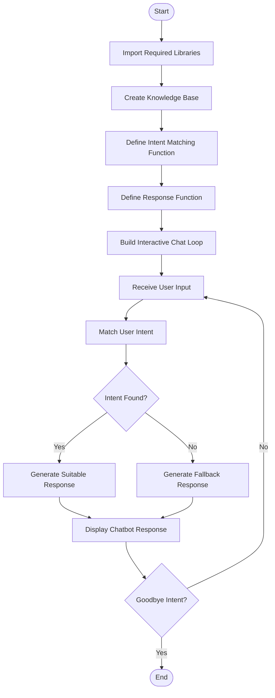

# EX-NO-8: Building a Simple College Admission Chatbot

## AIM

To design, implement, and test a simple rule-based chatbot in Python that answers frequently asked questions related to college admissions, such as courses offered, eligibility criteria, fees, application process, required documents, important dates, hostel facilities, and contact details.

---

## INTRODUCTION

A chatbot is a software application that simulates a conversation with a human user, typically through text.

A rule-based chatbot works by comparing the user's message against a predefined set of keywords or patterns and returning a suitable pre-written response.

It does not require large training datasets or heavy computation, making it a beginner-friendly approach to understanding conversational AI systems.

In this experiment, a **College Admission Chatbot** is developed to act as a virtual help-desk assistant that instantly answers common questions asked by prospective students.

### KEY FEATURES

- Answers frequently asked admission-related questions.
- Identifies user intent using predefined keywords and patterns.
- Provides multiple responses for different queries.
- Uses random response selection to avoid repetitive replies.
- Supports interactive conversations through the Python console.
- Handles unknown questions using a fallback response.
- Terminates the conversation when the user types `bye`, `exit`, or `quit`.

---

## WORKFLOW DIAGRAM



---

## PROCEDURE

### Step 1: Import Required Libraries

Two Python libraries are imported:

- **re:** Python's regular expression module, used to search for keyword patterns inside the user's message.
- **random:** Used to randomly select one response when multiple replies are available for the same intent.

**Code:**

```python
import re
import random
```

**Output:**

```text
Required libraries imported successfully.
```


### Step 2: Design the Knowledge Base (Intents and Responses)

The knowledge base is stored as a Python dictionary.

Each intent contains:

- **Patterns:** Keywords or phrases likely to appear in a user's question.
- **Responses:** Predefined answers returned by the chatbot.

The knowledge base contains the following admission-related topics:

1. Greeting
2. Courses
3. Eligibility
4. Fees
5. Application Process
6. Documents
7. Important Dates
8. Hostel Facilities
9. Contact Details
10. Goodbye

**Code:**

```python
knowledge_base = {
    "greeting": {
        "patterns": [r"\bhello\b", r"\bhi\b", r"\bhey\b"],
        "responses": [
            "Hello! Welcome to the College Admission Help Desk.",
            "Hi! How can I help you with college admissions?"
        ]
    },

    "courses": {
        "patterns": [r"\bcourses?\b", r"\bprograms?\b", r"\bbranches\b"],
        "responses": [
            "We offer courses in Engineering, Science, Arts, and Management.",
            "Our college provides undergraduate and postgraduate programs."
        ]
    },

    "eligibility": {
        "patterns": [r"\beligibility\b", r"\bqualification\b", r"\bmarks\b"],
        "responses": [
            "Eligibility depends on the selected course and admission guidelines.",
            "Students must satisfy the academic requirements for their chosen program."
        ]
    },

    "fees": {
        "patterns": [r"\bfees?\b", r"\btuition\b", r"\bcost\b"],
        "responses": [
            "The fee structure depends on the course and admission category.",
            "Please contact the admission office for the latest fee details."
        ]
    },

    "application": {
        "patterns": [r"\bapplication\b", r"\bapply\b", r"\badmission process\b"],
        "responses": [
            "You can apply through the college admission portal or admission office.",
            "Complete the application form and submit the required details."
        ]
    },

    "documents": {
        "patterns": [r"\bdocuments?\b", r"\bcertificates?\b", r"\bproof\b"],
        "responses": [
            "Required documents may include mark sheets, transfer certificate, ID proof, and photographs.",
            "Please prepare your academic certificates and identity documents."
        ]
    },

    "dates": {
        "patterns": [r"\bdates?\b", r"\bdeadline\b", r"\blast date\b"],
        "responses": [
            "Admission dates and deadlines are announced through the official college website.",
            "Please check the admission portal for the latest important dates."
        ]
    },

    "hostel": {
        "patterns": [r"\bhostel\b", r"\baccommodation\b", r"\blodging\b"],
        "responses": [
            "Hostel facilities are available for eligible students. Contact the hostel office for details.",
            "Please contact the college administration for hostel availability and fee information."
        ]
    },

    "contact": {
        "patterns": [r"\bcontact\b", r"\bphone\b", r"\bemail\b", r"\baddress\b"],
        "responses": [
            "Please visit the official college website for admission office contact details.",
            "You can contact the college admission office for further assistance."
        ]
    },

    "goodbye": {
        "patterns": [r"\bbye\b", r"\bexit\b", r"\bquit\b"],
        "responses": [
            "Thank you for contacting the College Admission Help Desk. Goodbye!",
            "Goodbye! Best wishes for your admission."
        ]
    }
}
```

### Knowledge Base Summary

| Intent | Example Keywords | Purpose |
|---|---|---|
| Greeting | Hello, Hi, Hey | Welcome the user |
| Courses | Courses, Programs, Branches | Course information |
| Eligibility | Eligibility, Marks, Qualification | Admission requirements |
| Fees | Fees, Tuition, Cost | Fee-related queries |
| Application | Apply, Application | Application procedure |
| Documents | Documents, Certificates | Required documents |
| Dates | Deadline, Dates, Last date | Admission schedule |
| Hostel | Hostel, Accommodation | Hostel information |
| Contact | Phone, Email, Address | Contact information |
| Goodbye | Bye, Exit, Quit | End the conversation |


### Step 3: Function to Match User Input to an Intent

The `match_intent()` function identifies the intent behind the user's message.

- Converts the user's sentence to lowercase so matching is not case-sensitive.
- Uses `re.search()` to scan the message for patterns belonging to each intent.
- Returns the first matching intent.
- Returns `None` if no pattern matches.

**Code:**

```python
def match_intent(user_input):
    user_input = user_input.lower()

    for intent, data in knowledge_base.items():
        for pattern in data["patterns"]:
            if re.search(pattern, user_input):
                return intent

    return None
```


### Step 4: Define the Chatbot Response Function

The `get_response()` function generates an appropriate response.

- Calls `match_intent()` to identify the user's intent.
- Uses `random.choice()` to select a response from the matched intent.
- Returns a fallback response when the intent cannot be identified.

**Code:**

```python
def get_response(user_input):
    intent = match_intent(user_input)

    if intent:
        return random.choice(
            knowledge_base[intent]["responses"]
        )

    return "Sorry, I didn't understand that. Please ask about courses, fees, eligibility, or admissions."
```

### Step 5: Build the Interactive Conversation Loop

The `chat()` function creates an interactive conversation between the user and the chatbot.

- `input()` continuously reads the user's message.
- `get_response()` generates a reply for every message.
- The loop ends when the user enters `bye`, `exit`, or `quit`.

**Code:**

```python
def chat():
    print("College Admission Chatbot")
    print("Type 'bye' to end the conversation.")

    while True:
        user_input = input("You: ")
        response = get_response(user_input)

        print("Bot:", response)

        if match_intent(user_input) == "goodbye":
            break
```

### Step 6: Test the Chatbot with Sample Queries

A list of sample questions is created to test the different intents in the knowledge base.

Each query is passed to the `get_response()` function, and the chatbot's reply is displayed.

**Code:**

```python
sample_queries = [
    "Hello",
    "What courses are available?",
    "What is the eligibility criteria?",
    "Tell me about the fees",
    "How can I apply for admission?",
    "What documents are required?",
    "What is the last date for admission?",
    "Do you have hostel facilities?",
    "How can I contact the college?",
    "Bye"
]

print("CHATBOT TESTING")
print("-" * 40)

for query in sample_queries:
    print("You:", query)
    print("Bot:", get_response(query))
    print()
```


### Step 7: Run the Complete Chatbot Program

The complete Python script is executed.

The sample queries are tested first to verify the different intents. The same `get_response()` function is also used in the live `chat()` loop for real-time conversation.

**Complete Python Program:**

```python
import re
import random

# Step 1 and 2: Knowledge Base
knowledge_base = {
    "greeting": {
        "patterns": [r"\bhello\b", r"\bhi\b", r"\bhey\b"],
        "responses": [
            "Hello! Welcome to the College Admission Help Desk.",
            "Hi! How can I help you with college admissions?"
        ]
    },

    "courses": {
        "patterns": [r"\bcourses?\b", r"\bprograms?\b", r"\bbranches\b"],
        "responses": [
            "We offer courses in Engineering, Science, Arts, and Management.",
            "Our college provides undergraduate and postgraduate programs."
        ]
    },

    "eligibility": {
        "patterns": [r"\beligibility\b", r"\bqualification\b", r"\bmarks\b"],
        "responses": [
            "Eligibility depends on the selected course and admission guidelines.",
            "Students must satisfy the academic requirements for their chosen program."
        ]
    },

    "fees": {
        "patterns": [r"\bfees?\b", r"\btuition\b", r"\bcost\b"],
        "responses": [
            "The fee structure depends on the course and admission category.",
            "Please contact the admission office for the latest fee details."
        ]
    },

    "application": {
        "patterns": [r"\bapplication\b", r"\bapply\b", r"\badmission process\b"],
        "responses": [
            "You can apply through the college admission portal or admission office.",
            "Complete the application form and submit the required details."
        ]
    },

    "documents": {
        "patterns": [r"\bdocuments?\b", r"\bcertificates?\b", r"\bproof\b"],
        "responses": [
            "Required documents may include mark sheets, transfer certificate, ID proof, and photographs.",
            "Please prepare your academic certificates and identity documents."
        ]
    },

    "dates": {
        "patterns": [r"\bdates?\b", r"\bdeadline\b", r"\blast date\b"],
        "responses": [
            "Admission dates and deadlines are announced through the official college website.",
            "Please check the admission portal for the latest important dates."
        ]
    },

    "hostel": {
        "patterns": [r"\bhostel\b", r"\baccommodation\b", r"\blodging\b"],
        "responses": [
            "Hostel facilities are available for eligible students. Contact the hostel office for details.",
            "Please contact the college administration for hostel availability and fee information."
        ]
    },

    "contact": {
        "patterns": [r"\bcontact\b", r"\bphone\b", r"\bemail\b", r"\baddress\b"],
        "responses": [
            "Please visit the official college website for admission office contact details.",
            "You can contact the college admission office for further assistance."
        ]
    },

    "goodbye": {
        "patterns": [r"\bbye\b", r"\bexit\b", r"\bquit\b"],
        "responses": [
            "Thank you for contacting the College Admission Help Desk. Goodbye!",
            "Goodbye! Best wishes for your admission."
        ]
    }
}


# Step 3: Match User Input to Intent
def match_intent(user_input):
    user_input = user_input.lower()

    for intent, data in knowledge_base.items():
        for pattern in data["patterns"]:
            if re.search(pattern, user_input):
                return intent

    return None


# Step 4: Generate Chatbot Response
def get_response(user_input):
    intent = match_intent(user_input)

    if intent:
        return random.choice(
            knowledge_base[intent]["responses"]
        )

    return "Sorry, I didn't understand that. Please ask about courses, fees, eligibility, or admissions."


# Step 5: Interactive Chat Function
def chat():
    print("College Admission Chatbot")
    print("Type 'bye' to end the conversation.")

    while True:
        user_input = input("You: ")
        response = get_response(user_input)

        print("Bot:", response)

        if match_intent(user_input) == "goodbye":
            break


# Step 6: Test the Chatbot
sample_queries = [
    "Hello",
    "What courses are available?",
    "What is the eligibility criteria?",
    "Tell me about the fees",
    "How can I apply for admission?",
    "What documents are required?",
    "What is the last date for admission?",
    "Do you have hostel facilities?",
    "How can I contact the college?",
    "Bye"
]

print("CHATBOT TESTING")
print("-" * 40)

for query in sample_queries:
    print("You:", query)
    print("Bot:", get_response(query))
    print()


# Step 7: Start Live Chat
chat()
```

---

## OUTPUT

### 1. Sample Conversation Output

The chatbot successfully identifies the greeting, courses, eligibility, fees, application, and documents intents.

**Expected output format:**

```text
CHATBOT TESTING
----------------------------------------
You: Hello
Bot: Hello! Welcome to the College Admission Help Desk.

You: What courses are available?
Bot: We offer courses in Engineering, Science, Arts, and Management.

You: What is the eligibility criteria?
Bot: Eligibility depends on the selected course and admission guidelines.

You: Tell me about the fees
Bot: The fee structure depends on the course and admission category.

You: How can I apply for admission?
Bot: You can apply through the college admission portal or admission office.
```

### 2. Remaining Conversation Output

The remaining queries about important dates, hostel facilities, and contact details are matched to their respective intents.

```text
You: What documents are required?
Bot: Required documents may include mark sheets, transfer certificate, ID proof, and photographs.

You: What is the last date for admission?
Bot: Admission dates and deadlines are announced through the official college website.

You: Do you have hostel facilities?
Bot: Hostel facilities are available for eligible students. Contact the hostel office for details.

You: How can I contact the college?
Bot: Please visit the official college website for admission office contact details.

You: Bye
Bot: Thank you for contacting the College Admission Help Desk. Goodbye!
```

**Note:** Since the chatbot uses `random.choice()`, the exact response may vary between executions.

## RESULT

A simple rule-based College Admission Chatbot was successfully designed, implemented, and tested using Python.

The chatbot identifies user intent through predefined keywords and regular expression patterns and generates suitable responses using a predefined knowledge base.

It successfully handles common admission-related queries, including courses, eligibility, fees, application procedures, required documents, important dates, hostel facilities, and contact details.

---

## CONCLUSION

Thus, a simple rule-based College Admission Chatbot was successfully developed using Python.

The experiment demonstrated the fundamental concepts of chatbot development, including knowledge base design, intent matching, pattern recognition, and response generation.

The chatbot provides a basic virtual help-desk system for answering frequently asked college admission questions. This experiment also provides a foundation for developing more advanced NLP-based and AI-powered conversational systems.

---

## FUTURE ENHANCEMENTS

- Integrate Natural Language Processing (NLP) for better understanding of user queries.
- Develop a graphical user interface using Tkinter or a web-based interface.
- Connect the chatbot to a database for storing admission information.
- Add multilingual support for regional languages.
- Integrate an AI model to handle questions outside the predefined knowledge base.

---

## REFERENCES

1. Python Documentation: https://docs.python.org/3/
2. Python Regular Expressions: https://docs.python.org/3/library/re.html
3. Python Random Module: https://docs.python.org/3/library/random.html

---
